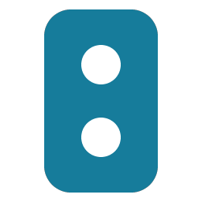

# Matter Button Events - Forked



Adds early button events for selected, already paired Matter devices. Uses the official Matter integration’s connection and keeps its existing entities.

**This project is entirely AI-generated and provided as-is, without any warranty or guarantees.** It has been tested and works in the author’s setup with IKEA BILRESA switches on Home Assistant 2026.10.4. Compatibility, reliability and suitability for other setups are not guaranteed.

Tested: initial press, short release, double-click, hold and integration reload. In three single-press tests, initial press arrived 550–600 ms before the regular single-click event.

## Installation

1. In **HACS → ⋮ → Custom repositories**, add `https://github.com/vNmven0m/matter-button-events` as type **Integration**.
2. Find **Matter Button Events** in HACS and download it.
3. Restart Home Assistant.
4. Go to **Settings → Devices & services → Add integration → Matter Button Events** and select an existing Matter device. Repeat for additional devices.

For manual installation, copy `custom_components/matter_button_events` into `config/custom_components/`, then follow steps 3–4.

Creates an **Early button** event entity for each compatible button endpoint. No re-pairing required. Devices must support the corresponding Generic Switch events.

## Events

| Event | When |
| --- | --- |
| `initial_press` | Button pressed, including the start of a hold or each press in a double-click |
| `short_release` | Short press released; not emitted after a hold |

Use the original Matter entities for double-click and long-press events.

## Automation example

Replace the example entity IDs:

```yaml
triggers:
  - trigger: event.received
    target:
      entity_id: event.example_remote_early_button_1
    options:
      event_type:
        - initial_press
actions:
  - action: light.turn_on
    target:
      entity_id: light.example
```

Keeping regular single-click triggers as fallback can run actions twice. Use explicit on/off rather than toggle; delayed actions can override newer commands.

## Removal

Remove early-event triggers from your automations and the **Matter Button Events** integration entries. Remove the download in HACS (or delete `custom_components/matter_button_events` for a manual installation) and restart HA. Existing Matter pairings remain.

## Development

Uses internal HA Matter interfaces, so HA updates may require changes. No additional connection, cloud service or polling.

With Python 3.14.2 or later:

```sh
python -m venv .venv
.venv/bin/pip install -r requirements-test.txt
.venv/bin/ruff check .
.venv/bin/ruff format --check .
.venv/bin/pytest -q
```

[MIT license](LICENSE).
